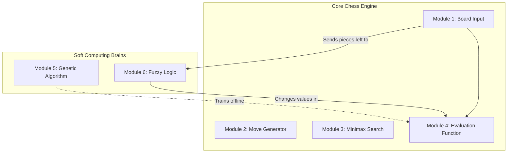
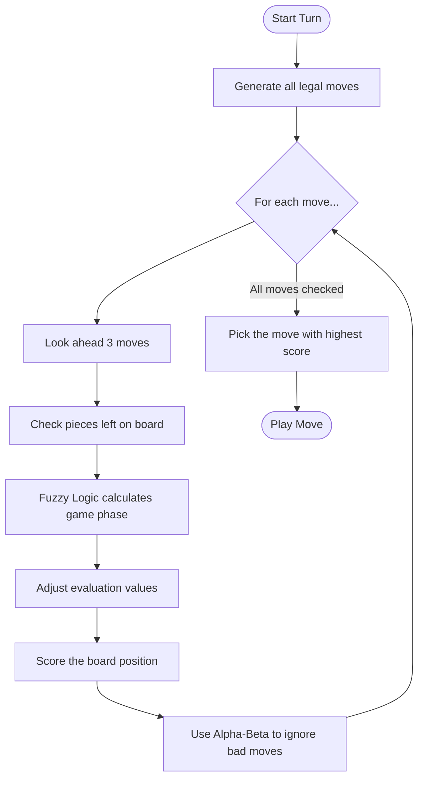

# Project Title: EvoFuzzy Chess: Adaptive Evaluation using Genetic Algorithms and Fuzzy Logic

## 1. Introduction
In the past, chess engines used fixed rules made by humans. For example, they always said a pawn is worth 1 point. Today, big engines like AlphaZero use deep learning, but they need very expensive computers to run.

This project uses a simpler and smarter way called Soft Computing. We built a chess engine that learns on its own without needing a huge computer. We use two main methods:
1. Genetic Algorithms (GA): This helps the computer learn the best values for chess pieces and positions automatically, so humans do not have to guess.
2. Fuzzy Logic: This changes those values smoothly as the game goes from the opening to the endgame.

## 2. Related Work

### 2.1 Research Paper Summaries
Our project is based on five important research papers.

1. A General Reinforcement Learning Algorithm that Masters Chess, Shogi and Go through Self-Play (Silver et al., 2018)
This is the famous AlphaZero paper by DeepMind. It shows how self-learning is the future of board games. While they use deep neural networks and supercomputers, it proves that an AI can learn to beat human masters from scratch. We include it to show the modern standard for chess AI.

2. Genetic Algorithms for Evolving Computer Chess Programs (David et al., 2014)
This paper showed that a computer can learn chess evaluation values using evolution, just like biology. It creates a population of chess programs, tests them, and breeds the best ones to reach grandmaster strength. We used this exact idea to teach our engine its base values without human bias.

3. Fuzzy adaptive genetic algorithms: design, taxonomy, and future directions (Herrera & Lozano, 2003)
This paper explains how to perfectly combine Fuzzy Logic with Genetic Algorithms. Instead of keeping algorithm settings fixed, they use fuzzy logic controllers to change them during the run. This prevents the AI from getting stuck and helps it find better solutions. We used this concept of combining fuzzy rules with GA to adapt our chess values.

4. Fuzzy Logic-Based Dynamic Difficulty Adjustment for Adaptive Game Environments (Paraschos & Koulouriotis, 2025)
This paper uses Fuzzy Logic to dynamically change the difficulty of a game while a person is playing it. The system looks at player health and uses fuzzy rules to change enemy behavior so the game is always challenging. We use this exact concept: our fuzzy logic system watches the board's material and smoothly changes the AI's playstyle.

5. Immune based fuzzy agent plays checkers game (Cheheltani & Ebadzadeh, 2012)
This paper builds an intelligent agent for playing checkers using a fuzzy inference engine. It proves that combining fuzzy logic with learning creates an AI that adapts to new opponent strategies on the fly without needing to calculate millions of moves. This validates our choice to use fuzzy logic to make our chess AI highly adaptable and fast.

(Add your Google Drive link here for the research papers)

### 2.2 The Research Gap
The papers above are great, but they all share one problem. They create one fixed set of values for the whole game.
But chess changes. Keeping your king safe is very important early in the game. But at the end of the game, your king needs to come out and fight. Fixed rules cannot handle this change well.

### 2.3 What We Are Working On (Our Solution)
We fix this problem by adding a Fuzzy Logic system on top of the Genetic Algorithm.
The Genetic Algorithm finds the best base values.
Then, the Fuzzy Logic system looks at how many pieces are left on the board. It smoothly shifts the values depending on whether it is the opening, middlegame, or endgame. This makes our AI much smarter as the game goes on.

## 3. Diagrams

### 3.1 Architecture Diagram
This shows how the 6 different modules in our project connect to each other.

### 3.2 Flow Chart
This shows the step-by-step process of how the AI decides to play a single move.

## 4. Implementation Details

Module 1: Board Input
The board is turned into 7 numbers to score the game:
1. Material: Total piece values. White minus Black.
2. Mobility: How many legal moves you have.
3. King Safety: How safe the king is behind pawns.
4. King Activity: How active the king is in the center.
5. Doubled Pawns: Penalty for two pawns on the same line.
6. Passed Pawns: Bonus for pawns that can promote safely.
7. Centre Control: Bonus for controlling the middle of the board.

Module 2 and 3: Move Generation and Search
Move Generation: We use a python library to find all legal chess moves.
Search Module: We use Minimax to look 3 to 4 moves into the future.
Optimization 1 "Alpha-Beta Pruning": The engine skips bad moves to save time.
Optimization 2 "Quiescence Search": If the engine stops looking during a piece capture, it might make a mistake. This search forces it to keep looking until all captures are done.

Module 4: Evaluation Function
This is the heart of the engine. It converts the board features (from Module 1) into a single score. It multiplies each feature by its assigned value (learned by the Genetic Algorithm and adjusted by Fuzzy Logic) and adds them all up to see who is winning. A positive total score means White is winning, and a negative score means Black is winning.

Module 5: Genetic Algorithm Training
The GA runs before you play to learn the best values.
It tests a population of random values. The ones that guess grandmaster moves correctly get to breed and pass on their numbers. We use multiple CPU cores to do this fast.

Module 6: Fuzzy Logic Playing
While you play, this module tracks the pieces left.
Instead of a hard rule like "turn 20 is the middlegame", it blends them. For example, it might say "30 percent middlegame, 70 percent endgame". It then multiplies the base values by these percentages.

Terminal Words Explained
Static Evaluation: The raw score of the board right now, before looking into the future.
Nodes: The number of board positions the AI tested in its brain.
Quiescence: The number of extra capture positions tested to avoid mistakes.

## 5. Results and Conclusion

To test our engine, we made the tuned engine play 50 games against an untuned engine. They played 25 standard openings, twice each, to be fair.

Total Games: 50
Wins for Tuned Engine: 23
Draws: 14
Losses: 13
Win Rate: 60 percent
Estimated Improvement: +70.4 Elo points.

Conclusion
The results prove our soft computing method works. The Genetic Algorithm learned better values than a human. The Fuzzy Logic module successfully changed those values during the game. This creates a highly adaptable chess AI without needing a giant supercomputer.
